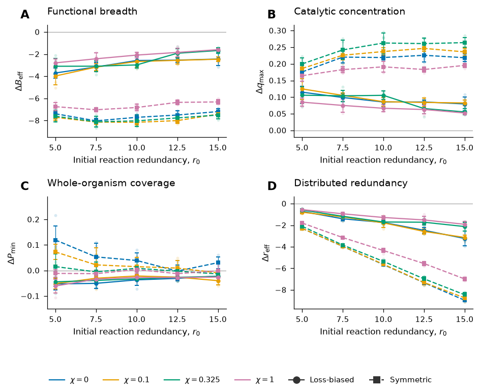

<p align="center"></p>

<p align="center">
<a href="pyproject.toml"></a>
<a href="uv.lock"></a>
<a href="docs/reproduction.md"></a>
</p>

A computational model of how overlapping catalytic contributions can evolve toward protein-level specialisation under selection on whole-organism reaction performance.

Companion software for **“A Minimal Model of Functional Redundancy as a Route to Enzyme Specialisation”**, Alp Duygu and Haziq Moinudeen, manuscript dated September 2026. Publication and preprint identifiers have not been supplied. The banner is an illustrative motif, not simulation data.

### Why overlapping activities matter

Promiscuous enzymes contribute weakly to multiple reactions. When several proteins supply the same reaction, the value of an activity change depends on contributions from the rest of the proteome. This model asks whether selection in that shared context can concentrate individual proteins' activities without gene duplication during the trajectories.

Across the supplied 200-run, 250-substitution dataset, all parameter-cell means lose effective breadth and gain strongest-function share. The symmetric mutation condition produces stronger concentration than the loss-biased condition; it is **not a neutral evolutionary control**. Weakest-reaction performance changes less uniformly, and structural incompatibility does not act as a monotonic specialisation pressure. These are model results, not evidence of a universal biochemical mechanism.

<p align="center"></p>

### The model

$$R_j=\sum_i a_{ij},\qquad P_j=\frac{R_j}{K_j+R_j},\qquad W=\prod_j P_j^{w_j}.$$

Activity is represented as a sum of loop contributions. Mutations act on latent loop support; an activity reaching zero can later recover. A local incompatibility constraint restricts feasible loop states. Exact finite-effect selection coefficients determine origin–fixation hazards. Ancestors have balanced reaction coverage, heterogeneous catalytic profiles, and $K_j=R_j(0)$, giving $P_j(0)=0.5$.

The scientific functions, probabilities, and defaults are preserved from the supplied implementation. Read the [model specification](docs/model.md) and the [scientific fidelity audit](reports/scientific_fidelity.md), including the inherited implementation discrepancies that require author review before public release.

### Reproduce the paper

Download or clone this repository, then enter its root directory. No GitHub URL is supplied here because no public remote has been established.

```sh
uv sync --locked --extra dev
make test
make smoke
make reproduce
```

`make reproduce` runs or resumes the full five-seed grid, validates the recorded 250-substitution endpoints against the source CSV, and regenerates figures. It skips validated completed trajectories. The included compact results allow `make figures` without rerunning simulations.

```sh
# Shared trajectories supply both endpoint analyses.
uv run python -m enzyme_specialisation simulate --config configs/paper.yaml --workers 4
uv run python -m enzyme_specialisation plot --experiment equal_total_250
uv run python -m enzyme_specialisation plot --experiment equal_exposure_c5
make validate

# Optional expansion: retain seeds 0–4 and run only missing trajectories.
uv run python -m enzyme_specialisation simulate --config configs/extended.yaml --workers 4
```

See [reproduction details](docs/reproduction.md) for seeds, checkpoints, runtime controls, and conventional pip installation. The quick smoke test uses fewer network swaps and two substitutions; it is not publication data.

**Completed:** 200 shared histories, 400 paired endpoint rows, 14 passing tests. The five principal saved endpoint metrics reproduce exactly. Full 250-event benchmarks show 8.5–10.3× speedups on the two measured workloads; these are machine-specific measurements.

### Two endpoints, one evolutionary history

| Comparison | Endpoint | Interpretation |
|---|---|---|
| `equal_total_250` | $n_{\mathrm{fix}}=250$ | Equal total fixed substitutions |
| `equal_exposure_c5` | $n_{\mathrm{fix}}=5N$ | Equal fixed substitutions per protein |

Each seeded trajectory runs once to $\max(250,5N)$. Both endpoint states are extracted from that history. The exposure coordinate is $x=n_{\mathrm{fix}}/N$; breadth curves compare all five redundancy conditions at matched exposure through $x=5$. Curves use non-anticipatory stepwise alignment, and bands show sample SD rather than a confidence interval. Full [captions](docs/figure_captions.md) accompany the artwork.

<p align="center"></p>

At $\chi=0.325$ under loss-biased mutation, the cell-mean breadth changes at $r_0=5$ and 15 are approximately −3.10 and −1.67 at 250 substitutions, compared with −2.59 and −3.86 at exposure 5. The endpoint choice therefore changes the apparent redundancy response. These descriptive comparisons carry no claim of statistical significance.

### Reproducibility and data

- Original source and small reference CSVs are preserved with [SHA-256 provenance](reports/source_inventory.json).
- Independent ancestry and evolution seeds match the original five-replicate registry. Parallel scheduling does not assign seeds.
- `uv.lock`, batch manifests, and recorded configurations identify the software environment, RNG, and parameters.
- Atomic checkpoints preserve activity, latent support, cached hazards, RNG, counters, and history. Tests exercise exact continuation.
- Compressed histories retain every substitution; CSV summaries keep stopping regimes separate. [Column definitions](docs/data_dictionary.md) explain metrics and units.
- [Regression validation](reports/regression_validation.md), [benchmarks](reports/performance_benchmark.md), and the [execution report](reports/execution_summary.md) report measured results and limits.

Compact reference data, paired endpoint data, and trajectories are supplied in this repository. No external archive or DOI is claimed. The unrelated research workspace is excluded.

```text
configs/              Paper, smoke, endpoint, and extended configurations
src/enzyme_specialisation/
                      Scientific kernels, simulator, experiments, analysis, CLI
data/reference/      Supplied publication tables and reference history
data/provenance/     Unmodified original simulation source
results/paper/        Paired endpoints and compressed trajectories
figures/              PDF, SVG, 600-dpi PNG, and README previews
reports/              Provenance, regression, performance, and execution evidence
docs/                 Model, data dictionary, captions, reproduction, release checklist
tests/                Deterministic scientific and checkpoint regressions
```

### Authors and citation

**Alp Duygu** — UCL Department of Chemistry.  
**Haziq Moinudeen** — UCL Cancer Institute, WE CARE Centre; Elizabeth Garrett Anderson Institute for Women's Health.

The manuscript marks the authors as equal contributors. Use [CITATION.cff](CITATION.cff) for the software and manuscript metadata. No DOI, ORCID, funding, or acceptance status has been inferred.

### Release status and licence

This is a local research repository prepared for review. **No open-source licence has been authorised.** The [rights notice](LICENSE) grants no additional permissions; author approval is required before public release. The [release checklist](docs/release_checklist.md) also records scientific audit items and publication metadata still requiring review. No private repository has been published.
