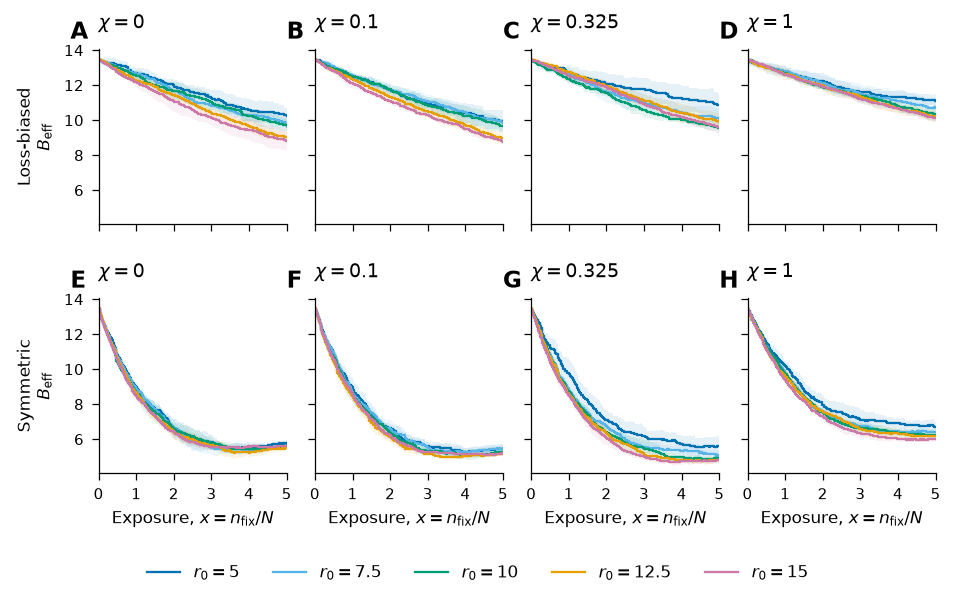

<p align="center"></p>

<p align="center">
<a href="pyproject.toml"></a>
<a href="uv.lock"></a>
<a href="LICENSE"></a>
</p>

# A Minimal Model of Functional Redundancy as a Route to Enzyme Specialisation

**Alp Duygu and Haziq Moinudeen**

Can selection on overlapping catalytic contributions produce specialised proteins without gene duplication? This project studies that question using stochastic origin–fixation simulations of weak generalist proteins supplying a shared set of organismal reactions.

## Scientific framework

Protein activities contribute to aggregate reaction capacity, which determines reaction performance and organismal fitness:

$$R_j=\sum_i a_{ij},\qquad P_j=\frac{R_j}{K_j+R_j},\qquad W=\prod_j P_j^{w_j},\quad w_j=1/M.$$

Each protein's activity profile is the sum of four loop contributions. Mutations act on a loop's latent reaction support and are subject to a local structural incompatibility constraint. An activity that reaches zero remains accessible to later positive mutations. Ancestors have balanced reaction coverage and heterogeneous catalytic profiles; setting $K_j=R_j(0)$ gives $P_j(0)=0.5$.

The simulations compare loss-biased and symmetric mutation kernels under selection. Protein number remains fixed throughout each trajectory. See the [model description](docs/model.md) for equations, mutation distributions, and summary statistics.

## Principal findings

At 250 fixed substitutions, effective functional breadth decreases and strongest-function share increases across all parameter-cell means. The symmetric mutation kernel produces stronger specialisation than the loss-biased kernel, demonstrating that a biochemical bias toward loss is not required for specialisation in this model. Redundancy and structural incompatibility modulate both protein-level concentration and weakest-reaction performance; their effects depend on the mutation condition and comparison endpoint.

<p align="center"></p>

Normalising evolutionary exposure by proteome size changes the apparent redundancy response. At $\chi=0.325$ under loss-biased mutation, mean breadth changes at $r_0=5$ and 15 are approximately −3.10 and −1.67 after 250 substitutions, compared with −2.59 and −3.86 after five substitutions per protein.

<p align="center"></p>

Figures show replicate means with sample-standard-deviation error bars or bands. The [figure captions](docs/figure_captions.md) describe each panel. Final artwork is available as [PDF, SVG, and 600-dpi PNG](figures/main), with [alternative presentations](figures/alternative) of the parameter response and paired endpoints.

## Simulation design

| Parameter | Values |
|---|---|
| Organismal reactions, $M$ | 120 |
| Proteins, $N$ | 40, 60, 80, 100, 120 |
| Initial redundancy, $r_0$ | 5, 7.5, 10, 12.5, 15 |
| Initial functions per protein | 15 |
| Loops per protein; loop supports | 4; (5, 4, 4, 4) |
| Initial total activity per protein | 0.30 |
| Structural incompatibility, $\chi$ | 0, 0.1, 0.325, 1 |
| Mutation kernels | Loss-biased; symmetric |
| Replicates | Five per parameter cell |

The 40-cell factorial design comprises 200 seeded trajectories and supplies two paired endpoint comparisons:

| Analysis | Endpoint | Comparison |
|---|---|---|
| `equal_total_250` | $n_{\mathrm{fix}}=250$ | Equal total substitutions |
| `equal_exposure_c5` | $n_{\mathrm{fix}}=5N$ | Equal substitutions per protein |

Each trajectory runs to $\max(250,5N)$ and records both endpoints. Exposure is $x=n_{\mathrm{fix}}/N$. Breadth curves use a common exposure grid through $x=5$, carrying forward the latest recorded state at or before each grid point.

## Installation and reproduction

Install [uv](https://docs.astral.sh/uv/getting-started/installation/), then:

```bash
git clone https://github.com/haziqmoinudeen-git/alp-duygu-functional-redudancy.git
cd alp-duygu-functional-redudancy
make install
make test
make smoke
make reproduce
```

`make reproduce` runs or resumes the five-replicate experiment, validates endpoint data, and generates the figures. Completed trajectories are checked and reused. Python 3.12.7 and the dependency versions in `uv.lock` define the computational environment.

```bash
# Run the paired experiment with a configurable worker count.
uv run python -m enzyme_specialisation simulate --config configs/paper.yaml --workers 4

# Regenerate artwork from the recorded data.
make figures

# Validate the complete dataset.
make validate

# Extend to 20 replicates per parameter cell.
uv run python -m enzyme_specialisation simulate --config configs/extended.yaml --workers 4
```

The released dataset contains five replicates per cell. The extended configuration reuses those replicates and adds deterministic seeds. Detailed [reproduction instructions](docs/reproduction.md) cover checkpoints, seed assignment, runtime controls, and individual analyses.

## Repository structure

```text
configs/                     Experiment and smoke-test configurations
src/enzyme_specialisation/   Model, simulation, analysis, plotting, and CLI
data/reference/             Reference endpoint tables and trajectory
data/provenance/            Reference implementation for numerical comparison
results/paper/               Paired endpoint tables and complete histories
figures/                     Publication artwork and previews
docs/                        Model, experiments, data dictionary, and reproduction
reports/                     Numerical validation and performance measurements
tests/                       Scientific and software tests
```

## Code and data availability

Source code, configurations, reference data, all 200 trajectory histories, and the 400 paired endpoint records are included in this repository. Compressed NPZ histories retain every fixed substitution and final activity matrices; CSV files provide replicate endpoints and cell-level summaries. The [data dictionary](docs/data_dictionary.md) defines each field. Batch manifests record configurations, seeds, RNG, software versions, and runtime information.

The [validation results](reports/regression_validation.md) and [performance measurements](reports/performance_benchmark.md) accompany the dataset. Numerical algorithms and their conventions are documented alongside the [model](docs/model.md).

## Citation and licence

Please cite **Alp Duygu and Haziq Moinudeen, “A Minimal Model of Functional Redundancy as a Route to Enzyme Specialisation.”** Machine-readable software and manuscript citation metadata are provided in [CITATION.cff](CITATION.cff).

Alp Duygu — UCL Department of Chemistry.<br>
Haziq Moinudeen — UCL Elizabeth Garrett Anderson Institute for Women's Health.

This project is distributed under the [MIT License](LICENSE).
